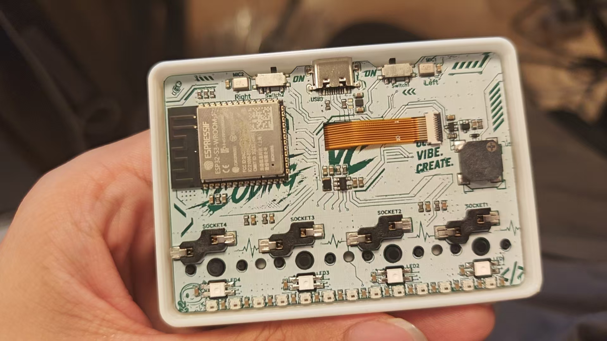

# 键盘硬件与恢复

[English](DEVICE.md) | 简体中文

产品使用 ESP32-S3 四键板，通过 USB 向 NomiFun 发送按键事件，并显示固定状态与 Nomi 表情。录音来自电脑的操作系统麦克风。完整功能见[产品设计](docs/design/nomifun-native-keyboard.zh.md)。

## 板型与身份核对

| 项目 | 支持的板型 |
|---|---|
| USB VID / PID | `303A:1001`，USB Serial/JTAG |
| 芯片 | ESP32-S3，40 MHz 晶振 |
| Flash / PSRAM | 16 MiB Flash / 8 MiB PSRAM |
| 产品应用 | `vibe_keyboard`，源码版本见 [固件入口](firmware/README.zh.md) |
| 应用槽位 | `ota_0@0x20000`，写入前核对实际分区 |

串口名称由操作系统分配，不能用 COM 号识别设备。`303A:1001` 是通用 ESP32 身份，连接后还须核对 native 协议、能力与稳定 ID。ROM MAC、已安装镜像版本/大小/哈希、安全配置和备份映射属于每台实物的本地档案，不写入公共源码文档。重新构建的输出与已安装镜像须分别核对，版本字符串相同不代表二进制相同。

## 板卡与接线

| 部件 | 当前固件接线 |
|---|---|
| 按键 | k1=GPIO0、k2=GPIO18、k3=GPIO17、k4=GPIO16；上拉、低电平按下 |
| 键帽图案 | ○=k1、★=k2、×=k3、麦克风=k4；固定执行 K1–K4，不提供校准或重映射 |
| 显示屏 | NV3007，428×142，RGB565，y 偏移 14 |
| 屏幕 SPI | MOSI21 / CLK14 / CS11 / DC13 / RESET12 |
| 背光 | GPIO9，LEDC PWM |

引脚定义来自[固定上游版本](https://github.com/zerob13/vibe-keyboard/tree/019cfa099c2cb3b8d7b9aad665dbc4fd4a09096a)，不是逐根电气测量结果。板载 PDM 引脚 GPIO41/40、GPIO8 灯条、滑动开关及无线模块不参与本产品；不得据外观推定麦克风型号、开关功能、电池或供电电路。新板型须重新核对接线与面板方向。

## Flash 分区

该板型的分区表位于 `0x8000`，源码布局见 [firmware/partitions.csv](firmware/partitions.csv)。每次写入前须独立读取实际分区并比对；下表不能代替实物核对。

| 分区 | 起始地址 | 大小 |
|---|---|---|
| nvs | `0x009000` | `0x004000` |
| nvs_keys | `0x00d000` | `0x003000` |
| phy_init | `0x010000` | `0x001000` |
| otadata | `0x011000` | `0x002000` |
| ota_0 | `0x020000` | `0x500000` |
| ota_1 | `0x520000` | `0x500000` |
| storage | `0xa20000` | `0x5e0000` |

## 恢复材料

16 MiB 板型的完整原厂备份应为 16777216 字节，存放在工程外的私有目录，按 ROM MAC 分开保存。备份含设备的 NVS、密钥及原厂存储，禁止不同设备互刷，不进入 Git、固件或 NomiFun 安装包。

本地档案应记录 ROM MAC、稳定 ID、备份路径与 SHA256、原厂应用 descriptor、已安装应用及独立读回结果。维护者的设备映射保存在被忽略的 `host/local/device-recovery-record.zh.md`，已刷应用副本和对应许可在 `host/local/flashed-images/`；`local-*.json` 与 `host/` 均不分发。历史探测文件可能对应另一台设备，操作时以当前 ROM 身份及独立读回为准。

## 写入与恢复边界

每次写入前须重新读取 ROM MAC、安全配置和实际分区，校验候选镜像的 descriptor、大小、SHA256 与该设备的完整原厂备份。应用镜像不得超过目标槽位，写入后须独立读回比对。

普通应用更新只在明确授权的应用分区进行。ESP-IDF 输出的全量 flash 命令不是操作授权；bootloader、分区表、NVS、OTA 元数据、storage 与 eFuse 不随应用更新修改。原厂完整恢复会覆盖设备数据，须单独确认恢复范围，并使用对应 MAC 的完整备份。
